# git-tui

A terminal command centre for your repositories. It is **read-only**: it shows local Git state, recent commits, open pull requests, tag-to-tag commit lists, what is deployed to each environment, what is not deployed yet, and deploy runs as they happen, across the repositories you configure.

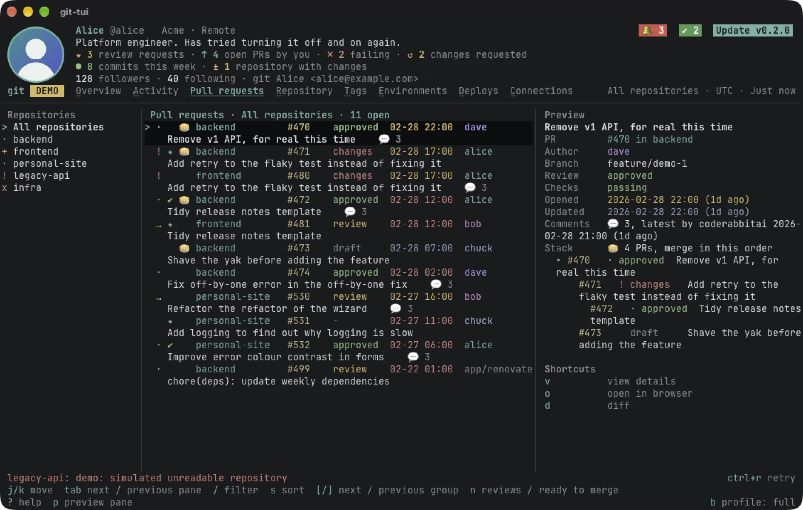

## Get started

You need Git, a GitHub account with access to `acme`, and Go 1.21 or newer, which fetches the Go version the app needs by itself (see [Prerequisites](#prerequisites)).

1. Install the `git-tui` command. The repository is private, so `GOPRIVATE` tells Go to fetch it with your Git credentials instead of asking public services:

   ```sh
   GOPRIVATE=github.com/acme go install github.com/shaungsimpson/git-tui/cmd/git-tui@latest
   git-tui -version
   ```

   The last line should print the newest release, such as `git-tui v0.3.0`. On the way you may see:

   ```text
   go: downloading github.com/shaungsimpson/git-tui v0.3.0
   go: github.com/shaungsimpson/git-tui@v0.3.0 requires go >= 1.26.0; switching to go1.26.10
   go: downloading github.com/shaungsimpson/git-tui v0.3.0
   ```

   That is normal: your Go is older than the 1.26 the app needs, so Go downloads 1.26 once and uses it. The second `downloading` line is the newer Go fetching the module again.

   If it fails:

   - `404 Not Found` from `sum.golang.org`: Go asked a public service about a private repository. Set `GOPRIVATE` as above, or once with `go env -w GOPRIVATE=github.com/acme`.
   - `could not read Username for 'https://github.com'`: Git cannot log in to GitHub. Run `gh auth login` and then `gh auth setup-git`, or if you use SSH keys, `git config --global url."git@github.com:".insteadOf "https://github.com/"`.
   - `command not found: git-tui` after a successful install: add Go's install directory to your `PATH`. `go env GOBIN` prints it; if that is empty, it is `$(go env GOPATH)/bin`, usually `~/go/bin`.
   - It installs an older version: Go has not seen a release tagged in the last few minutes. Use `@v0.3.0` (or whichever version) instead of `@latest`, or try again shortly.

2. Look around with made-up data. Nothing is read or sent:

   ```sh
   git-tui -demo
   ```

   Press `?` for the shortcuts and `Ctrl+C` to quit.

3. For pull requests, environments, deploys and your profile header, log in to the GitHub CLI once with `gh auth login`. Without it, the local Git views still work.

4. Run it, then press `a` to add the repositories you work on:

   ```sh
   git-tui
   ```

   It looks for git repositories under a folder (`~/Code` to start with; change it as you like), and you press `Space` on each one to add, then `Enter`. Each is named after its GitHub repository, or its folder. [Managing repositories](#managing-repositories) has the rest, and [Configuration](#configuration) the file it writes.

To update later, run the install command again; `git-tui -version` shows what you have, and so does the Connections view. An installed release checks for a newer one about once a day and says so in the header; see [Updates](#updates).

## Updates

git-tui tells you when a newer stable release exists, and how to install it by hand. It never installs anything or changes your checkout.

- **Which builds are checked.** Go records how a binary was built. A stable version installed with `go install …@v0.5.0` (or `@latest`) is a release, checked against the GitHub Release marked latest about once a day. A build from a clone, even one exactly on a release tag, is a source build. Anything else, such as `go install …@main`, is unknown. Source and unknown builds are never called out of date; `Ctrl+R` in Connections, or `git-tui -check-update`, shows the latest release on demand.
- **In the app.** When a newer release exists, an **Update v0.5.0** pill joins the badges at the right of the header (`[Update v0.5.0]` in the ASCII and text headers, the tab bar with the header off), so it reads without colour. The `git-tui` row in Connections shows the state (`up to date`, `update available`, `not checked`, `checking`, `check failed` or `not compared`), the version and kind of build, the executable, the latest stable release and how long ago it was checked, then what to do: the `go install` command pinned to the new version for a release; for a source build, how to rebuild it from the clone; for an unknown build, both, since the app cannot tell which applies.
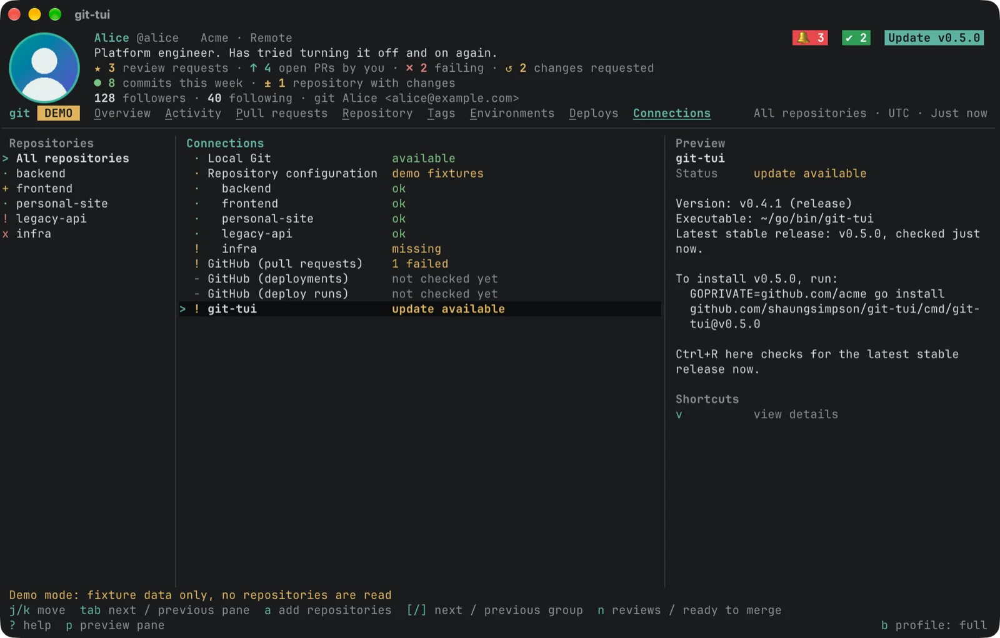

- **From the command line.** `git-tui -check-update` checks now, whatever the build, prints the same details and exits without starting the interface. It exits 0 when the check worked, whether or not there is a newer release, and 1 when it failed (after printing any earlier result). `-version` never checks.
- **How it checks.** One `gh api repos/shaungsimpson/git-tui/releases/latest` call (20-second timeout), so it needs `gh` logged in with access to the repository. Only a stable version (`vX.Y.Z`) is accepted. A successful check is cached in `$XDG_CACHE_HOME/git-tui/release.json` (default `~/.cache/git-tui/release.json`) and trusted for 24 hours across launches; a failed check is not cached, keeps the earlier result and its age on screen, and retries like any other load. A missing or unreadable cache only means checking again. Demo mode pretends to run the newest release tag it was built from and finds the next minor release (built after v0.10.0, it runs v0.10.0 and finds v0.11.0), so screenshots taken before a release show the version about to ship. It uses neither the network nor the cache.

## Prerequisites

- Go 1.26, or Go 1.21 or newer to fetch it: the module declares `go 1.26.0`, and with the default `GOTOOLCHAIN=auto` Go 1.21 and later download 1.26 automatically.
- `git` on `PATH`.
- Optional: the GitHub CLI (`gh`), logged in with `gh auth login`, for the Pull requests, Environments and Deploys views. Each repository's `origin` must point at github.com. A repository with no `origin` remote yet, such as one not pushed to GitHub, is not an error: the status line notes `no origin remote yet (not pushed to GitHub)` and its local views work as usual.
- A terminal at least 60×16. The sidebar appears from 100 columns, and from 120 a preview pane beside the list shows the selected item's key details and the shortcuts that act on it. It never takes focus: `v` opens the full detail page. `p` hides it, giving the list its width: on a 14-inch laptop that keeps rows on one line. When the list is narrower than 100 columns, rows take two lines: commits, pull requests and deploy runs put their title on the second, Overview and Tags their last commit's subject, and Environments the deployed ref and any failed or pending attempt. Everything else stays on the first line, including the author when it fits; a long author follows the title instead of being cut off.

No Nerd Font or image support is required.

## Configuration

The configuration file is a small JSON file:

```json
{
  "repositories": [
    { "name": "backend", "path": "~/Code/backend", "group": "work" },
    { "name": "frontend", "path": "~/Code/frontend", "group": "work" },
    { "name": "dotfiles", "path": "~/Code/dotfiles", "group": "personal" }
  ]
}
```

The file is selected in this order:

1. `-config FILE`
2. `$GIT_TUI_CONFIG`
3. `$XDG_CONFIG_HOME/git-tui/config.json`, which defaults to `~/.config/git-tui/config.json`

`~` is expanded. Each repository is validated on its own: a missing directory or a directory without `.git` is marked unavailable, and the app still opens. If no configuration file exists, the app opens and offers to add repositories, creating the file when you do. You can also write it by hand; start from `examples/config.example.json`. `name` is optional: a repository without one is named after its folder, and when two folders share a name, the later one gets its parent folder in front (`personal/api`). `group` is optional too: any name you like, one per repository, which lets you show that group on its own (see [Groups](#groups)). Versions of git-tui before groups refuse a file that uses `group`. Without a home folder (and no `-config` or `$GIT_TUI_CONFIG`), there is no configuration file, and nothing is remembered or cached.

## Managing repositories

The Connections view (`g c`) lists each configured repository under "Repository configuration". There:

| Key | Action |
|-----|--------|
| `a` | Add repositories (also offered from any view while none are configured) |
| `r` | Rename the selected repository. Names must be unique |
| `e` | Set its group. `Tab` cycles the existing groups that start with what you typed; a new name makes a new group, one matching an existing group in another case joins it, and an empty one takes the repository out of its group |
| `x` | Remove it from the list, after a `y` to confirm. The folder is not touched |
| `K` / `J` | Move it up or down; the sidebar and Overview follow this order |
| `f` | On a missing repository: find its folder again |

Adding looks for git repositories up to 3 folders below the folder you give, skipping hidden folders, `node_modules`, `vendor`, and the inside of a repository it found (so submodules are not listed). It follows links: a linked starting folder is searched, and a project linked into it is listed. A relative folder is taken from where you started git-tui and saved as a full path. It starts in the folder you used last, else the folder your repositories share, else `~/Code`. Repositories already configured are marked `[·]`. A name already in use gets its parent folder in front, such as `client-x/api`; rename it afterwards if you like. `x` and `f` also work on the repository selected in the sidebar while it has focus, so you can remove or find a missing one from any view. `f` looks the same way and puts the cursor on a folder with the repository's old folder name, or its name, and `Enter` points the repository there.

![Adding repositories: folders found under a starting folder, one already configured and marked [·], two chosen with Space](docs/images/add-repositories.webp)

Each change is saved straight away. A repository keeps what it has already loaded when the list is reordered; a renamed one reloads its local Git data, which carries the name, but not its GitHub data.

You can configure two folders cloned from the same GitHub repository, such as a second checkout or a worktree on another branch. Each keeps its own branch, status, commits and diff. They share the GitHub data: pull requests, environments and deploys load once and are listed once, under the first folder's name, and the header counts them once. Paths under your home folder are written with `~`. The previous file is kept beside it as `config.json.bak`. If `config.json` is a link (into a dotfiles repository, say), the file it points to is written and the link stays, even when that file does not exist yet. If the file changed since git-tui loaded it, such as an edit by hand, nothing is saved and the status line asks you to restart, so your edit is not lost. Before anything is replaced, the new file is read back the way the app reads it at start-up, so a change from inside the app cannot leave a file it would reject. If the configuration failed to load (for example a typo in the JSON), these keys are not offered: fix the file by hand, so nothing you wrote is overwritten.

### Groups

Once a repository has a group, `]` and `[` cycle what is shown: all repositories, then each group, A to Z. Repositories without a group show only under all. A hidden repository leaves the sidebar, every view and the header counts and badges, and nothing loads for it: no git and no `gh` calls. Connections still lists it, marked `hidden by the group`, so you can change its group. The sidebar's title names the group shown and how many of the repositories it holds (`Repositories · work 4/5`). Showing a group reloads its repositories' local Git data straight away; GitHub data reloads only if it is more than a minute old, so switching back and forth makes no extra `gh` calls. When the selected repository is hidden, the selection moves to all repositories. When the last repository leaves the group shown, all are shown again.

## Remembered preferences

The time zone (`u`), the date format (`w`), the PR status style (`c`), the profile header style (`b`), whether the preview pane is shown (`p`), each list's sort (`s`), whether descriptions are formatted (`m`), the group shown (`]` and `[`) and the folder adding repositories last looked in are remembered between runs in `$XDG_STATE_HOME/git-tui/state.json`, which defaults to `~/.local/state/git-tui/state.json`. Besides this file, the app writes only the update check's cache (see [Updates](#updates)), and the configuration file and its `.bak` when you change the repository list. A `-profile` flag wins over the remembered header for that run. Demo mode neither reads nor saves preferences.

## Demo mode

`-demo` uses deterministic built-in fixtures. A `DEMO` badge appears in the header, and the status bar says no repositories are read. The fixtures include one repository that fails to read and one that is missing, so you can see the error and unavailable states; among the folders you can add, `acme-mobile` has not been pushed to GitHub yet. Demo mode shows every feature: the profile header with a generated avatar and every count lit, and PR pictures drawn from generated mock screenshots, all without touching the network. The paths it shows are fixtures too (repositories under `(demo)/`, `git` at `/usr/bin/git`, git-tui in `~/go/bin`), so screenshots of it never show your machine's folders or account name. `t`, `T` and `Ctrl+T` are offered in any terminal and say what they would open, without opening anything. Managing repositories works on the list in memory and saves nothing; adding finds fixture folders, including one whose name clashes and the folder the missing `infra` repository moved to. "This week" counts back from the fixtures' own date. Normal mode never falls back to fixtures.

## Views

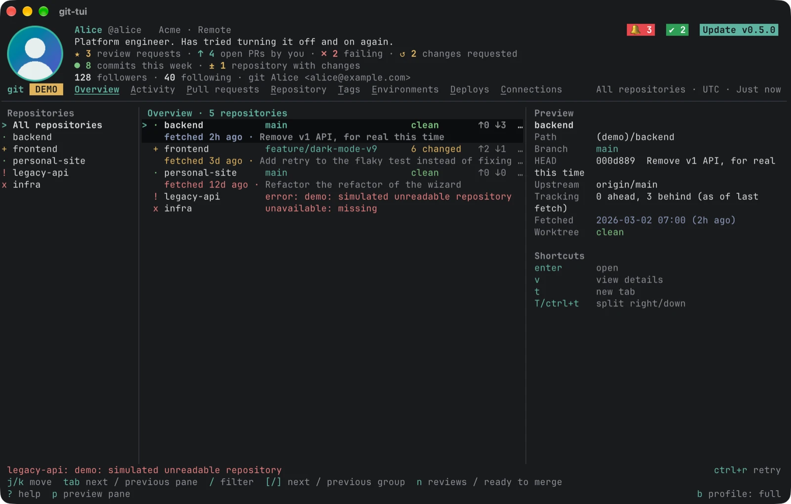

| View        | Shows                                                                                   |
|-------------|-----------------------------------------------------------------------------------------|
| Overview    | Per repository: branch, worktree state, ahead/behind, how long ago it last fetched (amber after a day, red after a week), latest commit |
| Activity    | Recent commits (100 per repository), merged by date, for all repositories or the one selected |
| Pull requests | Open PRs with review state, a ★ when your review is requested (directly or through a team), draft flag and combined check status (passing, pending, failing). A 🥞 marks a stacked PR: one based on another open PR's branch, or one that others are based on (a PR from a fork is never a base). With the ASCII or text header it is drawn as `=`, like the badges, for terminals without emoji. The preview and detail page list its whole stack in merge order, indented by depth, with the selected PR marked ▸. A 💬 with a number counts its comments: conversation comments plus reviews with a summary (`#3` with the ASCII or text header). The preview says who commented last and when. Its detail page (`v`) shows the description, formatted (see [Descriptions](#descriptions)), then the comments and review summaries, oldest first, each review with its state (a bot's comment shows only its heading until `z` opens it), then the changed files; `d` shows the PR's code diff |
| Repository  | Branch, HEAD, upstream, tracking, last fetch and worktree for the selected repository, plus its commits: first those on its upstream branch that you fetched but have not pulled (up to 50), then its recent ones. The last fetch line also says how many newer commits GitHub has that you have not fetched |
| Tags        | Tags; mark one as the base and pick another to list the **commits** between them        |
| Environments | Per environment, the newest successful GitHub deployment (commit, ref, time) and any newer failed or running attempt. Enter lists commits on `origin/HEAD` that the deployment does not contain |
| Deploys     | Recent deploy workflow runs: status, duration, branch and link. A failed or cancelled run says why it stopped, as GitHub recorded it. While a run is queued or running, the view reloads by itself, less often the longer the run goes on |
| Connections | What is available: local Git, the config and each configured repository (managed here, see [Managing repositories](#managing-repositories)), GitHub pull requests, deployments and deploy runs (from what those views last loaded), and git-tui itself: its version and kind of build, where it is installed, the latest release and how to update it (see [Updates](#updates)) |

Lists start newest first. `s` cycles the current list's sort; within each group the rows stay newest first, and the pane title shows any sort other than the default:

| View          | Sorts                                     |
|---------------|-------------------------------------------|
| Activity      | date, repository, author                  |
| Pull requests | updated, status, repository, author       |
| Repository    | date, author                              |
| Environments  | deployed, repository, environment         |
| Deploys       | started, status, repository, workflow     |

Pull requests by status puts what needs you first: your review requests, then your PRs ready to merge, failing checks, changes requested, awaiting review, approved, and drafts last. Deploys by status lists running runs, then failed or cancelled ones, then successes. Overview keeps your order (`K`/`J`) and Tags stay newest first.

In Pull requests, a green **✔** in the column after the check status marks your own PR that is ready to merge: approved, every check passing, and not a draft. Its detail page says "Ready: ✔ approved, checks passing". Merge conflicts are not checked.

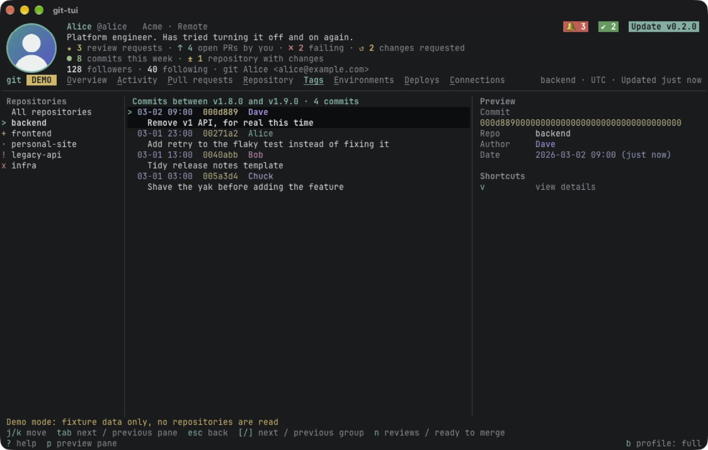

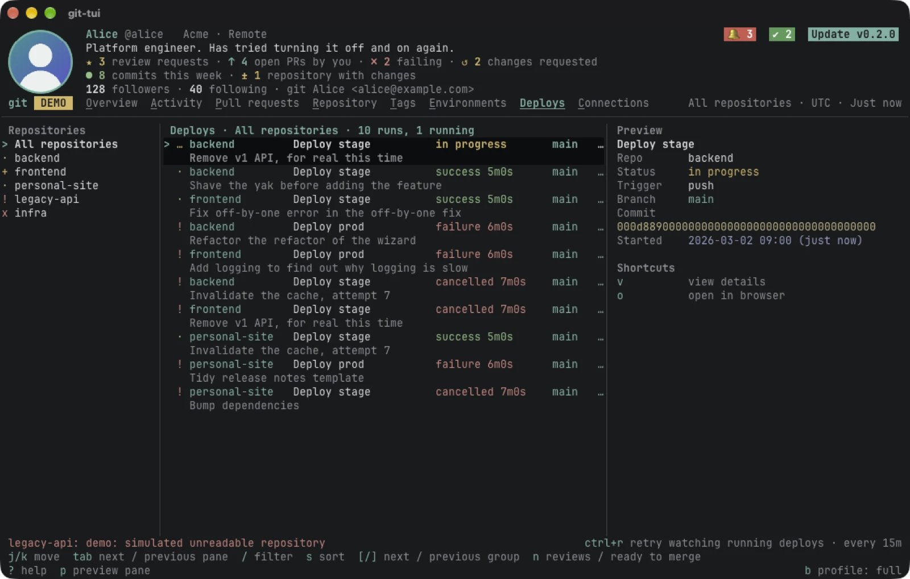

In Pull requests, a **★** in the column after the check status means someone has asked for your review, either you directly or a team you belong to. Its detail page repeats it as "Requested: ★ your review". The star comes from GitHub's `review-requested:@me` search, so it disappears once you submit a review, and comes back if you are asked again. It sits apart from the review column, which shows the PR's overall state (approved, changes, review, draft). If the search fails, the list still loads without stars until the next refresh.

In Pull requests, a PR's time shows when it was last updated, and its colour shows how long it has been open: blue for under a day, amber from one day and red from three days. Drafts stay blue, and a draft marked ready counts from when it was opened. The detail page shows "Opened" in the same colour.

The review column shows the full word (approved, changes, review, draft), a letter (`A` `C` `R` `D`), a symbol (`✓` `✗` `?` `◌`) or an emoji (👍 🔧 👀 📝); `c` cycles them. Full words become letters on lists under 60 columns, and emoji become symbols with the ASCII or text header.

Authors are coloured so you can follow a person down a list: the same name always gets the same colour, ignoring case and punctuation (`Jane Doe` and `jane.doe` match). Your own name, as your GitHub login, display name or git name, is in the accent colour (a PR author must match your login exactly), and bots such as `renovate[bot]` and GitHub Apps (`app/dependabot`) are grey. A GitHub login and a git name for someone else can still get different colours, since nothing links them.

Tag comparisons are plain commit lists. Each commit on `main` is titled like a PR and ends in its PR number `(#number)`, whether the PR was squash-merged or rebase-merged one commit per item; no feature summaries are invented. Environments show what **GitHub Deployments recorded**, not what the running service reports: a workflow can record success without the service serving that commit. "Not yet deployed" uses your local clone, so it is as current as your last `git fetch`; if the deployed commit is newer than your clone, the view says so. Ahead/behind and incoming commits reflect your last `git fetch`, since git-tui never fetches; Overview shows how long ago that was, and the status line suggests `git fetch` when the selected repository last fetched over a day ago or GitHub has commits it has not fetched.

## Profile header

Above the tabs, a header shows who you are and what is waiting for you, across every configured repository: your GitHub name, handle, company, location and bio, review requests (★), your open PRs, how many of them are failing or have changes requested, your commits this week, repositories with uncommitted changes, followers, and your local git identity. It needs `gh` for the GitHub parts; without it, the header still shows your git identity and the local counts.

Two badges stand out at the right of the header's first line whenever there is something to act on:

- A red **🔔 3** badge counts the open PRs waiting on your review (the ★ ones), and a green **✔ 2** badge counts your PRs ready to merge. Counts above 9 show as `9+`. A badge is hidden at zero and until pull requests load; if a load fails, the last good count stays.
- In the ASCII and text headers they are drawn as `[! 3]` and `[ok 2]`, and a stacked PR's 🥞 as `=`, so pick one of these headers if your terminal does not draw emoji. With the header off, or hidden because the window is short, they move to the tab bar, which drops the repository name, then the time zone, before the tabs to make room.
- When the review count goes up while the app is open, the red badge pulses for about three seconds and the status line says `Someone asked for your review. Press n to see it.` While reviews are waiting, the window title reads `git-tui (3)`, so you can see it from another tab.
- `n` lists the PRs behind them, and the footer shows `n reviews / ready to merge` while either badge is lit: see [Keyboard](#keyboard).

Press `b` to cycle it (the choice is remembered), or start with `-profile`:

| Mode    | Shows |
|---------|-------|
| `full`  | Your avatar beside a five-line banner (default) |
| `ascii` | The same banner in plain ASCII, the avatar drawn with characters |
| `text`  | One line of counts, zeros left out |
| `off`   | Nothing |

![The profile header in ASCII mode, its badges drawn as [! 3], [ok 2] and [Update v0.11.0]](docs/images/header-ascii.webp)

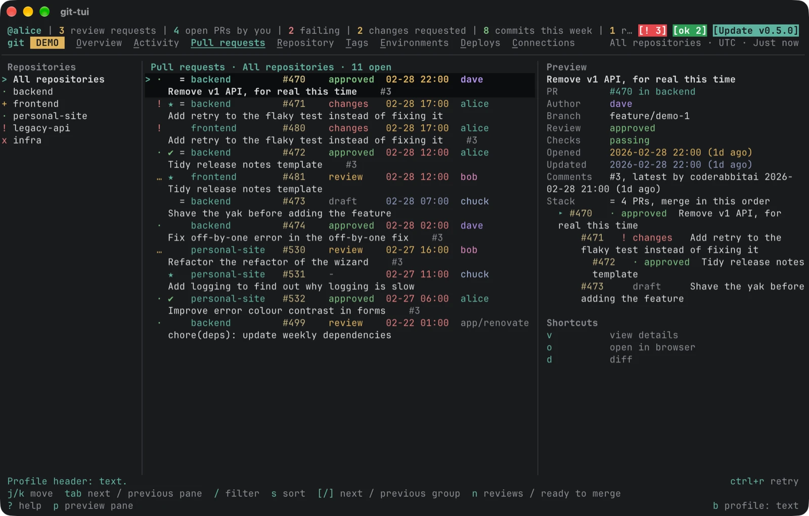

The header degrades to what the terminal can show:

- Avatar: the real picture, cropped to a circle with an accent-coloured border, in Kitty and Ghostty (outside tmux), coloured half blocks in other terminals with 256 colours or more, characters with fewer colours or `NO_COLOR`, and your initials in a frame until it loads or when there is no picture.
- Height: the banner becomes the one-line header when it would leave the panes fewer than 10 lines, and is hidden when even that would. The footer's second line gives way before either.

## Keyboard

The footer lists the shortcuts that apply right now. When they do not fit on one line it takes a second, unless that would leave the panes fewer than 10 lines or shrink the profile header; then the others give way first so `?` help stays visible. While the preview pane is shown, the footer leaves the selected row's shortcuts to it. The footer keeps its height while you type a filter or answer a question, so the panes do not jump. `?` lists every key, available or not, grouped: those that work everywhere first, then lists, the detail page and repositories; `j`/`k`, `PgUp`/`PgDn` and `Home`/`End` scroll it when it does not fit.

| Key               | Action                                                                     |
|-------------------|----------------------------------------------------------------------------|
| `j` `k` / `↓` `↑` | Move the selection in the focused pane                                     |
| `PgUp` / `PgDn`   | Move a page in the focused pane: a screenful of rows in a list or the sidebar, or of text on the detail page, help, a diff and the add screen. On a Mac laptop, `Fn+↑` / `Fn+↓` |
| `Home` / `End`    | Go to the first or last row, or the top or bottom of the text             |
| `Tab` / `Shift+Tab` | Move focus between visible panes                                         |
| `v`               | View the selected item's details on a page of their own, across the whole window: a PR's description, pictures and files, a commit's message, why a deploy run stopped. On the page `j`/`k` scroll, `PgUp`/`PgDn` page, `Home`/`End` go to the top or bottom, `J`/`K` step to the next or previous item, and `o` and `d` still apply |
| `Enter`           | From the sidebar, move to the list. In Overview: open the Repository view. In Tags: choose the base tag, then the head tag. In Environments: list commits not yet deployed |
| `Esc`             | Close the detail page, the comparison, the base selection or the filter    |
| `/`               | Filter the current list (`Enter` applies, `Esc` cancels), by text and by age: see [Filtering](#filtering). In Pull requests, `is:review` keeps your review requests and `is:ready` your PRs ready to merge |
| `s`               | Sort the current list: Activity, Pull requests, Repository, Environments and Deploys (see [Views](#views)). Remembered between runs |
| `n`               | Go to Pull requests across all repositories, filtered to your review requests (`is:review`); again for your PRs ready to merge (`is:ready`); again to show every PR |
| `g` then `o` `a` `p` `r` `t` `e` `d` `c` | Go to Overview, Activity, Pull requests, Repository, Tags, Environments, Deploys or Connections (1 second timeout). Each tab underlines its letter |
| `Ctrl+R`          | Refresh everything on screen now, including failed loads; in Connections, also check for a newer release |
| `?`               | Every shortcut, grouped by where it applies                                |
| `p`               | Show or hide the preview pane (120 columns and wider). Remembered between runs |
| `F2`              | Toggle the dark and light themes                                           |
| `d`               | Show a diff: on a pull request, its code changes; on a repository with uncommitted changes (Overview row, sidebar or Repository view), those changes in sections for staged, unstaged and untracked. `j`/`k` scroll, `PgUp`/`PgDn` page, `Home`/`End` go to the top or bottom, `Esc` closes |
| `o`               | In Pull requests and Deploys: open the selected PR or run in your browser (https links only), with `open` on macOS, `wslview` on WSL when it is installed, and `xdg-open` otherwise |
| `t` / `T` / `Ctrl+T` | Open a new terminal tab, a split to the right, or a split below, at the selected repository's root (Overview row, sidebar or Repository view). Ghostty 1.4 or later on macOS, or Windows Terminal on WSL, outside tmux; elsewhere the keys are hidden |
| `u`               | Show times in UTC or your local time zone (shown in the header)           |
| `w`               | Cycle how list rows show dates: numeric (`2026-03-02 06:00`, without the year on narrow lists), relative (`3h ago`, the date once it is a week old), short (`2 Mar 06:00`) or weekday (`Mon 2 Mar 06:00`). Dates from an earlier year show the year instead of the time. Detail pages always show the exact time and how long ago. Remembered between runs |
| `c`               | Cycle how Pull requests rows show review status: full word, letter, symbol or emoji. Remembered between runs |
| `b`               | Cycle the profile header: full, ASCII, text, off (always shown at the right of the footer) |
| `]` / `[`         | Show the next or previous group: all repositories, then each group. Offered once a repository has a group. See [Groups](#groups). Remembered between runs |
| `a` `r` `e` `x` `K` `J` `f` | In Connections: add, rename, group, remove, reorder or find repositories; `x` and `f` also work in the focused sidebar. See [Managing repositories](#managing-repositories) |
| `m`               | On a PR's detail page: show its description and comments formatted or as markdown source. Remembered between runs. See [Descriptions](#descriptions) |
| `z`               | On a PR's detail page: open or close the description's `<details>` sections and bots' comments |
| `Ctrl+C`          | Quit                                                                       |

Links are blue and underlined: the Link row of a pull request or deploy run, the links in a PR description, and any `https://` URL in a commit message. Your terminal opens them, not git-tui: Cmd+click in Ghostty on macOS, Ctrl+click in Windows Terminal, and the like in other terminals that support OSC 8 hyperlinks. Elsewhere they still look like links; copy the URL, or press `o` to open the PR or run.

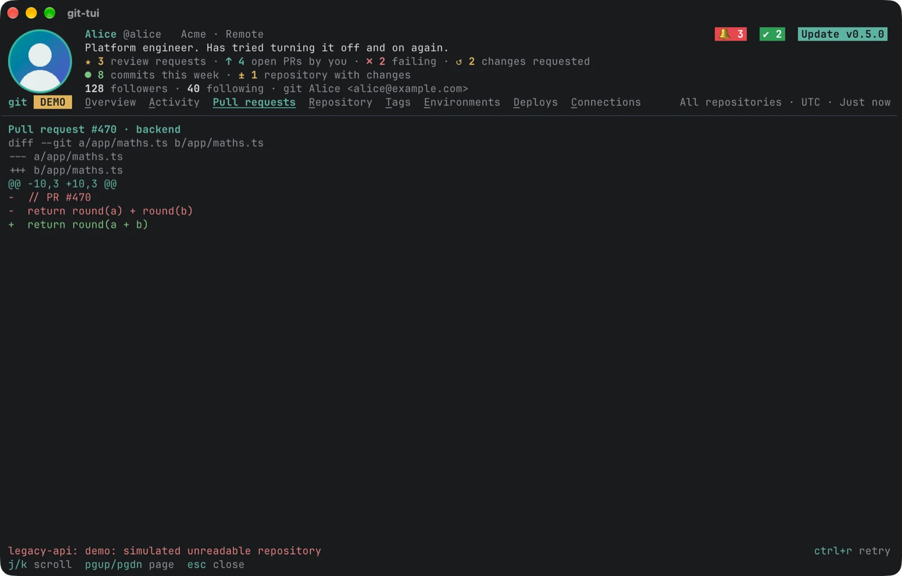

### Descriptions

A pull request's description is formatted on its detail page, the way GitHub shows it: headings, bold and italic, `code`, lists and task lists (☐ ☑), quotes, alerts such as `> [!NOTE]`, rules, code blocks and tables. A link shows its text, blue and underlined; hover over it to see where it goes. A table lines up its columns in the window's width, cutting the widest short with `…`; when a column would get narrower than 8 characters, each row is shown as its own block of header and value lines instead. A picture on a line of its own is drawn (see [Scope and behaviour](#scope-and-behaviour)); one within text or a table cell, such as a badge, shows its alt text and is not downloaded. HTML comments are hidden, and other HTML shows its text. `<details>` sections are closed, showing their summary (`▸ Release notes`); `z` opens every section on the page (`▾`) and closes them again, and they close when you move to another PR. `m` shows the markdown source instead (the heading reads `Description · raw`), with its URLs linked; it is remembered between runs. Footnotes and anything else not formatted show as plain text. The description is cut at 200 lines; `o` opens the rest on GitHub. Comments are formatted the same way, each cut at 200 lines; a bot's comment starts closed like a `<details>` section, and `z` opens it with the rest.

A pull request's detail page, opened with `v`:

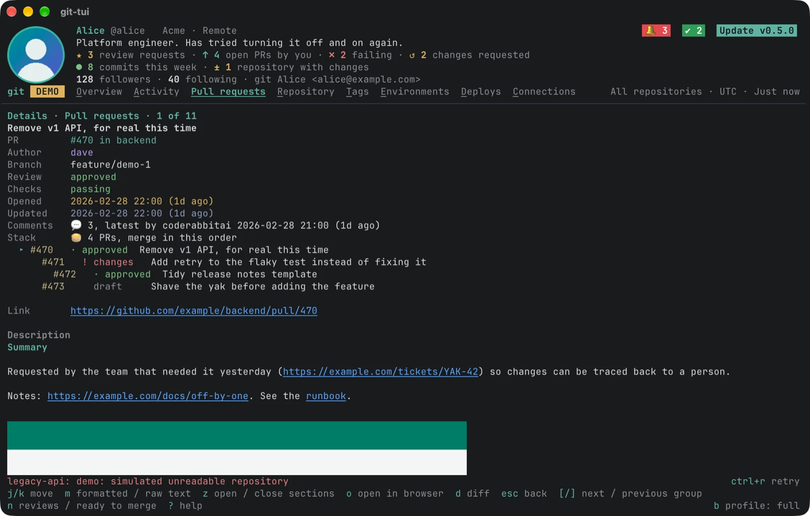

The end of the page: comments and review summaries, a bot's folded until `z`, then the changed files:

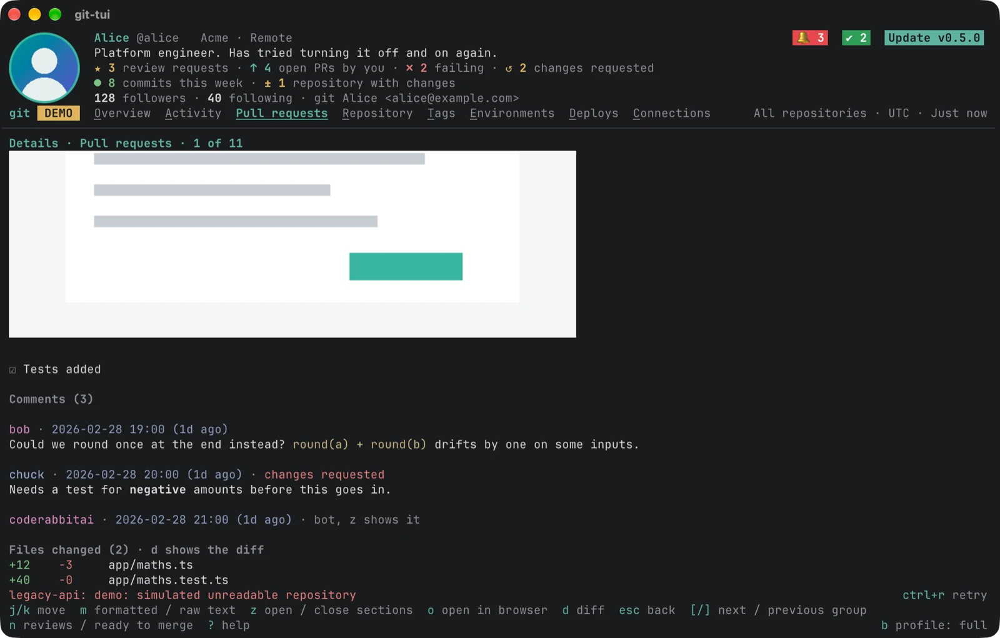

The light theme (`F2`), and an 80×24 window, where the sidebar and preview pane give way to the list:

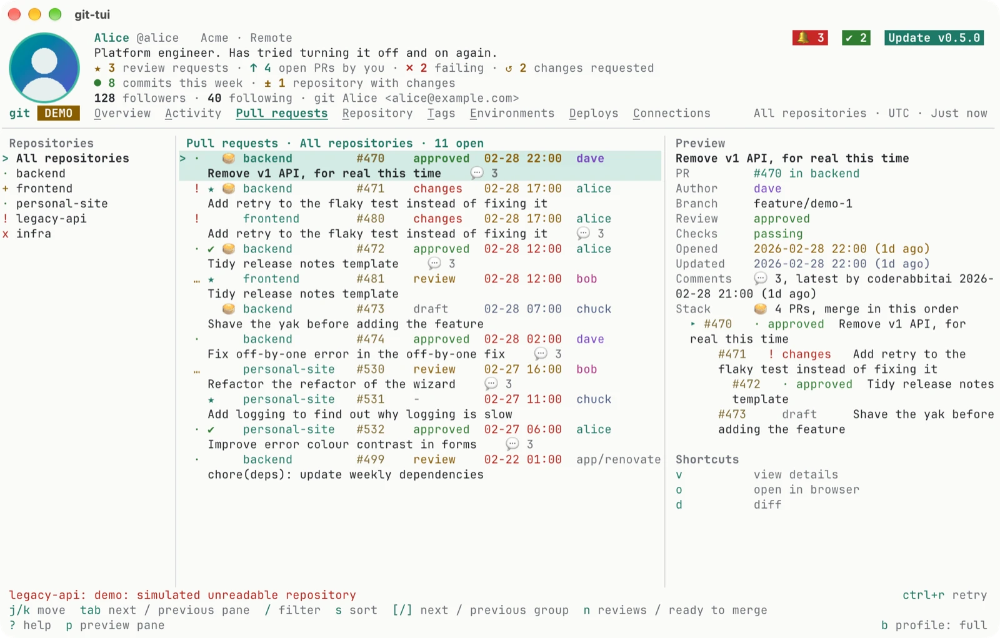

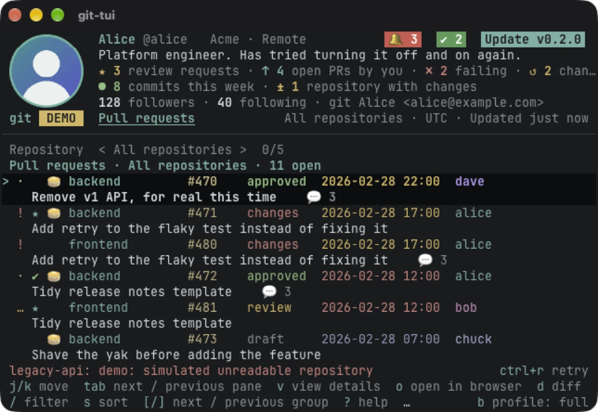

### Filtering

A filter keeps the rows that contain its text, ignoring case. It can also hold time terms, which keep rows by age: `>3d` older than three days, `<1w` from the last week, and `1d..1w` between one day and one week old. Units are `m`, `h`, `d` and `w`. Every term must match, so `renovate >3d` keeps Renovate's rows older than three days, and `is:review >2d` the review requests opened over two days ago; the words left over match as one phrase. Each list compares its own date: the commit in Activity and Repository, when the PR was opened in Pull requests (the date its colour shows), the tag in Tags, the deployment in Environments, the start of the run in Deploys, and the latest commit in Overview. A row without a date never matches a time term, and anything that is not a valid term, such as `>3x`, is matched as text.

While the filter, rename or folder input is open, all typing and pasted text go to the input, not to shortcuts.

## Scope and behaviour

- Git is run with argument arrays in each repository's directory, with a 5-second timeout. A program git started that outlives the timeout gets 1 more second before the call gives up on it. `GIT_TERMINAL_PROMPT=0` and `GIT_OPTIONAL_LOCKS=0` are set, so it never prompts and never refreshes the index, and `core.fsmonitor` is turned off. Repositories in the config are trusted: git may still run programs their own config names, such as clean filters (Git LFS is one), as it does in your shell.
- Only `status`, `log`, `for-each-ref`, `diff`, `ls-files`, `rev-parse` (to find the folder holding `FETCH_HEAD`, whose modification time is when the clone last fetched, and the commit the upstream branch was at), `remote get-url` and `config user.name` / `config user.email` (your git identity in the profile header) are run (adding repositories reads each found repository's `origin` with `remote get-url` to name it); `diff` uses `--no-ext-diff --no-textconv`, so a repository's own diff programs never run. There is no fetch, pull, checkout or tagging.
- GitHub calls go only to a remote whose host is github.com itself (or, over SSH, a host alias such as `github.com-work`).
- Pull requests are read with `gh pr list`, their comment counts with `gh api graphql` (the newest 100 reviews per PR; a failed count only hides the counts), a pull request's comments and review summaries with `gh api graphql` (the newest 100 of each, while its detail page is open, reloaded every minute and as soon as the list's count changes), deployments with `gh api graphql`, deploy runs with `gh run list`, why a selected run failed or was cancelled with `gh api graphql` (its jobs' failure annotations, read once per run, when its detail page is open), how many commits the Repository view's branch has on GitHub past your last fetch with `gh api repos/…/compare` (for the repository on screen only, when its upstream is on `origin`), and a pull request's diff with `gh pr diff` (20-second timeout, or 60 seconds for the pull request and run lists, which `gh` fetches 100 at a time; up to 300 open PRs, 100 environments, the newest 50 deployments per environment and the newest 300 workflow runs).
- A deploy run is a run of a workflow named "deploy" (except pull request checks), or of the same workflow, trigger and branch as a run that recorded a GitHub deployment. That covers pipelines such as a main-branch CI/CD workflow without counting its pull request runs.
- Data on screen refreshes by itself when it is stale: local Git data after 5 seconds, GitHub data (pull requests and an open PR's comments, environments, deploys) after 1 minute, and your GitHub profile after 30 minutes. Staleness is checked once keys pause for 150 ms (so holding `j` through the sidebar, or `J` through PRs, loads only where it stops), when you come back to the window, when it is resized, and on a 1-minute idle tick while the window is focused. The tick pauses while the window is in the background and after 10 minutes without a key press, so an open but unused window makes no `gh` calls. Repositories hidden by the group shown never count as on screen (see [Groups](#groups)). Every other repository's pull requests and your GitHub profile always count as on screen, since the review and ready-to-merge badges show in every header mode. With the profile header shown, every repository's commits and status do too, since the header counts them; with it off, the rest refreshes only for the current view. The right of the tab bar says how old the data is (`Updated 3m ago`), or `Updating…` while a refresh runs; when the tabs need the room it shortens to `3m ago` (or `Just now`), then gives way.
- Deploys also reloads by itself while a deploy is queued or running: every minute for its first 30 minutes, then every 5 minutes, and every 15 minutes once it has gone on for 2 hours (a run waiting for an approval or a free runner can wait for days). The newest unfinished run sets the pace, and runs the idle refresh has just reloaded are skipped. It stops when nothing is running, when you leave the view, when a reload fails, or while the window is in the background and unused for 10 minutes; the next key, or returning to the window, starts it again. Nothing is written to GitHub.
- Pictures in PR descriptions are drawn in the terminal in Ghostty and kitty (Kitty graphics protocol with Unicode placeholders), not inside tmux; other terminals, including WezTerm for now, show the picture's name instead. Only PNG, JPEG and GIF pictures hosted on GitHub are downloaded (on github.com, only from its attachments folder), up to 10 MB and 16 megapixels each, two at a time, once the PR's detail page is open; leaving the page cancels those still downloading. Your `gh` login token is sent to github.com only, because attachments in private repositories need it; it is not sent on to GitHub's storage host. Anything else, such as SVG or images on other sites, is named in the text instead. Demo mode never downloads pictures; it draws generated ones.
- A failed load keeps the last good data on screen and retries by itself after 1, 2, 4 and 8 minutes, then every 10 minutes; Ctrl+R retries at once, pictures and your avatar included, and the status line shows a `ctrl+r retry` hint.
- `t`, `T` and `Ctrl+T` run `osascript` with Ghostty's own AppleScript commands to open a tab in the front window, or split the focused pane (1-minute timeout, so there is time to answer the macOS permission prompt). A relative repository path is made absolute first. The repository path is passed as an argument, not written into the script. The first time, macOS may ask to let Ghostty control Ghostty; if you refuse, the key shows the error. On WSL inside Windows Terminal (`WT_SESSION` set and `wt.exe` on the path), they run `wt.exe -w 0 new-tab` (or `split-pane -V` / `-H`) with `wsl.exe -d <your distribution> --cd <path>` in the current window, as an argument list with the same timeout; a path containing `;` is refused, because Windows Terminal reads it as the start of another command. Demo mode only says which directory it would open.
- Besides your repositories' pull requests, deployments and runs, the app reads your GitHub profile (`gh api user`), downloads PR pictures and your avatar from GitHub's hosts (pictures on github.com itself with the login token from `gh auth token`, 5-second timeout), and checks for a newer git-tui release (see [Updates](#updates)). Nothing else goes over the network.
- Links are OSC 8 hyperlinks, sent to every terminal: one that does not support them ignores the code and shows the text, still blue and underlined. tmux passes them on from 3.4 with `set -as terminal-features ",*:hyperlinks"`. Only `https://` links are made clickable. In a formatted description a link shows its text; in the markdown source and in commit messages each URL is linked exactly as shown, leaving out a full stop or unmatched bracket after it. Diffs are not linked. git-tui never captures the mouse, so selecting text works as usual.
- Loads run asynchronously. A refresh keeps the existing content visible, and results from superseded requests are discarded.
- Paths in your home folder (repositories, the configuration file, the executable, `git` and `gh`) are shown from `~`, so a screenshot does not give away your account name.
- Text from Git (subjects, branch names, errors) has its control characters, escape sequences and text direction overrides removed before display.

## Working on git-tui

The [development guide](docs/development/README.md) covers building, testing, the checks a pull request must pass, regenerating the screenshots (with the one-off macOS setup), releasing, and the code layout. [AGENTS.md](AGENTS.md) has the definition of done and the design principles, for people and coding agents alike.
